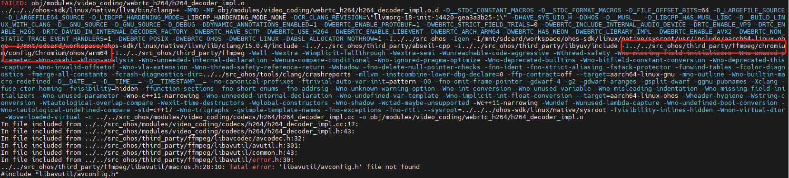

# WebRTC适配/使用时遇到问题总结

## 问题1：编译ffmpeg动态库时提示：ld.lld error: duplicat symbol: _init

修改`build/toolchain/ohos/BUILD.gn`, 将引入问题的`crti.o`,`Scrt1.o`屏蔽掉：

```shell
ohos_libc_dir =
    rebase_path(invoker.sysroot + "/" + invoker.lib_dir, root_build_dir)
# libs_section_prefix = "${ohos_libc_dir}/Scrt1.o"
# libs_section_prefix += " ${ohos_libc_dir}/crti.o"
# libs_section_postfix = "${ohos_libc_dir}/crtn.o"
if (invoker.target_name == "ohos_clang_arm") {
  abi_target = "arm-linux-ohos"
} else if (invoker.target_name == "ohos_clang_arm64") {
  abi_target = "aarch64-linux-ohos"
} else if (invoker.target_name == "ohos_clang_x86_64") {
  abi_target = "x86_64-linux-ohos"
}
clang_rt_dir =
    rebase_path("${clang_lib_path}/clang/15.0.4/lib/${abi_target}/",
                root_build_dir)
print("ohos_libc_dir:", ohos_libc_dir)
print("clang_rt_dir:", clang_rt_dir)
#solink_libs_section_prefix = "${ohos_libc_dir}/crti.o"
#solink_libs_section_prefix += " ${clang_rt_dir}/clang_rt.crtbegin.o"
#solink_libs_section_postfix = "${ohos_libc_dir}/crtn.o"
#solink_libs_section_postfix += " ${clang_rt_dir}/clang_rt.crtend.o"
```

## 问题2：增加 `rtc_use_h264=true` `rtc_use_h265=true` 时FFmpeg编译不过问题

- h264/h265依赖了ffmpeg三方库，默认情况下，ohos平台未配置ffmpeg的编译，故需要在`third_party\ffmpeg\ffmpeg_generated.gni`添加ohos平台配置：

  ```shell
  use_linux_config = is_linux || is_chromeos || is_fuchsia || is_ohos
  ```

- 编译时提示无法找到`libavutil/avconfig.h`
  
  
  
  通过分析可知，其依赖的头文件是`third_party/ffmpeg/chromium/config/Chromium/ohos/arm64`，当前目录并没有ohos，可将linux拷贝一份作为ohos

  ```shell
  cd third_party/ffmpeg/chromium/config/Chromium/
  cp -arf linux ohos
  ```

**注意：添加了h264/h265后，需要添加ffmpeg的依赖库，即编译时需将is_component_ffmpeg开关打开。配置后的编译命令如下：**

```shell
gn gen ../out/ohos_webrtc --args='is_clang=true target_cpu="arm64" target_os="ohos" rtc_use_dummy_audio_file_devices=true rtc_use_h264=true rtc_use_h265=true is_component_ffmpeg=true'       # 音频模块移植适配完后需把`rtc_use_dummy_audio_file_devices=true`去掉
ninja -C ../out/webrtc -v -j32
```

以上配置是使用`ffmpeg_branding`的默认配置，如果配置`ffmpeg_branding="Chrome"`的话，依赖头文件目录是`third_party/ffmpeg/chromium/config/Chrome/ohos/arm64`，故需拷贝`Chrome`下的配置：

```shell
cd third_party/ffmpeg/chrome/config/Chromium/
cp -arf linux ohos
```

## 问题3：使用时提示链接错误

1. 提示"recompile with -fPIC"

原因：编译.a时都时静态未添加-fPIC选项，导致链接时出错。

解决方法：在//build/config/compiler/BUILD.gn中的thin_archive里添加fPIC

```shell
config("thin_archive") {
  # The macOS and iOS default linker ld64 does not support reading thin
  # archives.
  # TODO(crbug.com/1221615): Enable on is_apple if use_lld once that no longer
  # confuses lldb.
  if ((is_posix && !is_nacl && !is_apple) || is_fuchsia) {
    arflags = [ "-T" ]
  } else if (is_win && use_lld) {
    arflags = [ "/llvmlibthin" ]
  }
+  if (is_ohos) {
+    cflags = [ "-fPIC" ]
+    cflags_cc = [ "-fPIC" ]
+    ldflags = [ "-fPIC" ]
+  }
}
```

2. openh264相关接口的找不到

链接时缺少libffmpeg.so动态库。libwebrtc.a依赖了动态库libffmpeg.so，编译链接时需要加上此依赖库。
