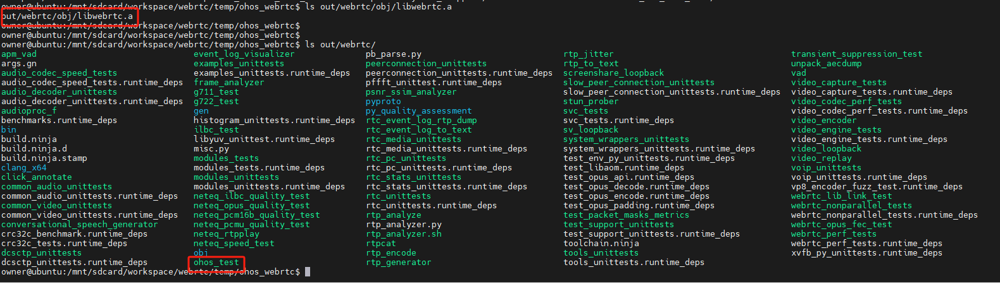
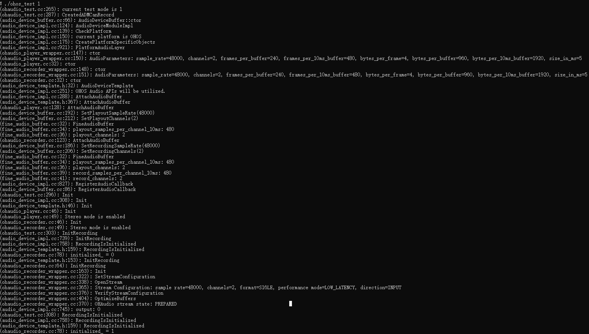

# WebRTC编译指导

## 简介

WebRTC (Web Real-Time Communications) 是一项实时通讯技术，它允许网络应用或者站点，在不借助中间媒介的情况下，建立浏览器之间点对点（Peer-to-Peer）的连接，实现视频流和（或）音频流等任意数据的传输。<br/>
本仓库代码是基于webrtc m120版本(commitid: b0cc68e61205fd11a7256a6e85307ec17ad95790)进行开发的。

## 编译前准备

### 编译环境

- ubuntu 20.04.1
- webrtc版本（m120，commitid:b0cc68e6）
- OpenHarmony SDK版本(4.0.10)

### 源码准备

- 安装depot_tools

  创建工作目录webrtc，cd  到自己创建的工作目录，拉取工具：

  ```shell
  mkdir webrtc
  cd webrtc
  git clone https://chromium.googlesource.com/chromium/tools/depot_tools.git
  ```

  成功后，将工具路径添加到环境变量中：

  ```shell
  vi ~/.bashrc                                    # 在.bashrc文件的末尾添加下面一行代码
  export PATH="$PATH:/xxx/webrtc/depot_tools"


  source ~/.bashrc                                # 配置完环境变量后使环境变量生效
  ```

- 获取代码
  
  ```shell
  cd webrtc
  git clone https://gitee.com/openharmony-sig/ohos_webrtc.git     # 下载本仓库代码
  ```

- OpenHarmony SDK获取

  使用者可以从openHarmony SDK [官方发布渠道](https://gitee.com/openharmony-sig/oh-inner-release-management/blob/master/Release-Testing-Version.md)获取对应版本的SDK，也可以从社区发布对应4.0版本获取对应的SDK，如 [OpenHarmony 4.0 Release](https://gitee.com/openharmony/docs/blob/master/zh-cn/release-notes/OpenHarmony-v4.0-release.md#%E4%BB%8E%E9%95%9C%E5%83%8F%E7%AB%99%E7%82%B9%E8%8E%B7%E5%8F%96)。

## 源码编译

### 手动编译

- 下载依赖三方库
  
  webrtc原库依赖了近300个开源三方库，当前基于满足OHOS交叉编译集成了一个较小的[依赖三方仓](https://gitee.com/zhong-luping/webrtc_third_party),下载方法如下:

  ```shell
  cd ohos_webrtc                                                    # 进入到webrtc源码目录
  git clone https://gitee.com/zhong-luping/webrtc_third_party.git   # 下载依赖仓
  mv webrtc_third_party/third_party ./                              # 将三方库目录移到wenrtc根目录
  rm -rf webrtc_third_party                                         # 删除多余文件夹
  ```

- 下载子模块
  
  ```shell
  cd ohos_webrtc                                    # 进入到webrtc源码目录
  git submodule update --init --recursive           # 同步子模块
  ```

- 执行编译命令
  
  编译时除了需配置基本的信息外，还需要配置SDK的路径，其变量名称为：`ohos_sdk_native_root`,其路径需要配置到sdk的native目录。具体编译配置如下：

  ```shell
  gn gen out/webrtc --args='is_clang=true target_cpu="arm64" target_os="ohos" ohos_sdk_native_root="/owner/workspace/ohos-sdk/linux/native/"'  # ohos_sdk_native_root 需要配置用户自己SDK的路径
  ninja -C out/webrtc -v -j32                 # 执行编译，-v 查看编译的具体过程， -j32使用32个线程进行编译，提升编译速度
  ```

  编译成功后会在out/webrtc/obj目录下生成libwebrtc.a, 在out/webrtc目录下生成对应的测试用例，其中ohos_test是视频了OH平台的音频测试用例。
  
  

### 自动编译

  除上述手动操作编译外，也可以通过本仓库提供的`build.sh`文件进行自动编译，执行自动编译时需要注意的是需要用户提供自己本地SDK路径，具体方式如下:

  ```shell
  cd ohos_webrtc                                        # 进入到webrtc源码目录
  ./build.sh /owner/workspace/ohos-sdk/linux/native/    # 执行build.sh 脚本，后面参数需是用户本地的SDK路径，具体到native目录。
  ```

## 测试验证

编译成功后将测试用例(out/webrtc下的测试用例)以及测试资源(webrtc源码目录的resoure)推送到OpenHarmony设备中进行测试，此处以ohos_test进行测试说，该测试用例可以用来测试音频的播放以及录制。

```shell
./ohos_test 1     # 参数说明：0(播放，依赖resource下的音频文件，resource需要放在/data/目录), 1(录制), 2(同时录制与播放)。
```


