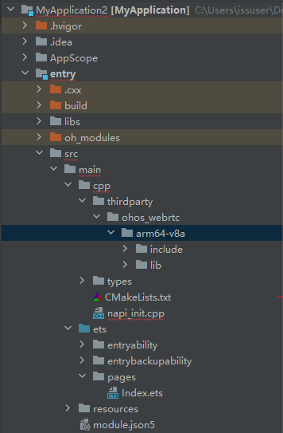

# 北向应用使用webrtc二进制文件

## 简介

北向应用集成webrtc的方法除了通过[源码方式集成](https://gitcode.com/CPF-ApplicationTPC/tpc_c_cplusplus/blob/master/docs/adapter_thirdlib.md)，也可以直接集成已交叉编译好的二进制文件。本文主要介绍如何将二进制文件集成到应用中。

**注意：集成到北向应用的二进制文件必须是通过OpenHarmony的SDK交叉编译生成的，不能是通过rom方式编译生成的。**

## 集成方法

### 交叉编译webrtc

交叉编译的方法可以参照文档[webrtc_adapter_ohos.md](./webrtc_adapter_ohos.md)

### 获取webrtc头文件

进入webrtc目录，执行下面shell脚本

```shell
#!/bin/bash

mkdir include

src=`find ./ -name "*.h*"`
for obj in $src
do
	echo "$src"
	cp --parents $obj ./include
done
```

include目录即是webrtc所需头文件

### 应用中调用webrtc

1. 将webrtc生成的二进制文件拷贝到应用工程目录

   为了更好的管理应用集成的ohos_webrtc，在应用工程的cpp目录新建一个thirdparty目录，将生成的二进制文件以及头文件拷贝到该目录下，如下图所示,ohos_webrtc代表的是三方库名称，ohos_webrtc文件夹下包含了arm架构以后aarch64架构2种方式生成的二进制文件，每种架构目录下包含了该库的头文件(include)以及二进制文件(lib)：

   

2. 配置相关参数

   配置相关参数只需要在cpp目录的CMakeLists.txt文件中添加

   ```cmake
   set(CMAKE_CXX_STANDARD 17)
   set(WEBRTC_PATH ${CMAKE_CURRENT_SOURCE_DIR}/thirdparty/ohos_webrtc/${OHOS_ARCH}/include)
   ```

3. 配置对应链接

   配置链接只需要在cpp目录的CMakeLists.txt文件中添加对应`target_link_libraries`即可：

   - 配置静态库链接

   ```cmake
   target_link_libraries(entry PUBLIC ${CMAKE_CURRENT_SOURCE_DIR}/thirdparty/ohos_webrtc/${OHOS_ARCH}/lib/libwebrtc.a)
   ```

4. 配置头文件路径

   配置链接只需要在cpp目录的CMakeLists.txt文件中添加对应`target_include_directories`

   ```cmake
   target_compile_definitions(entry PUBLIC -DWEBRTC_POSIX)
   target_include_directories(entry PUBLIC ${WEBRTC_PATH})
   target_include_directories(entry PUBLIC ${WEBRTC_PATH}/third_party/abseil-cpp)
   target_include_directories(entry PUBLIC ${WEBRTC_PATH}/third_party/boringssl)
   target_include_directories(entry PUBLIC ${WEBRTC_PATH}/third_party/catapult)
   target_include_directories(entry PUBLIC ${WEBRTC_PATH}/third_party/crc32c)
   target_include_directories(entry PUBLIC ${WEBRTC_PATH}/third_party/dav1d)
   target_include_directories(entry PUBLIC ${WEBRTC_PATH}/third_party/ffmpeg)
   target_include_directories(entry PUBLIC ${WEBRTC_PATH}/third_party/fontconfig)
   target_include_directories(entry PUBLIC ${WEBRTC_PATH}/third_party/fuzztest)
   target_include_directories(entry PUBLIC ${WEBRTC_PATH}/third_party/google_benchmark)
   target_include_directories(entry PUBLIC ${WEBRTC_PATH}/third_party/googletest)
   target_include_directories(entry PUBLIC ${WEBRTC_PATH}/third_party/harfbuzz-ng)
   target_include_directories(entry PUBLIC ${WEBRTC_PATH}/third_party/icu)
   target_include_directories(entry PUBLIC ${WEBRTC_PATH}/third_party/jsoncpp)
   target_include_directories(entry PUBLIC ${WEBRTC_PATH}/third_party/libaom)
   target_include_directories(entry PUBLIC ${WEBRTC_PATH}/third_party/catapult)
   target_include_directories(entry PUBLIC ${WEBRTC_PATH}/third_party/libc++)
   target_include_directories(entry PUBLIC ${WEBRTC_PATH}/third_party/libc++abi)
   target_include_directories(entry PUBLIC ${WEBRTC_PATH}/third_party/libevent)
   target_include_directories(entry PUBLIC ${WEBRTC_PATH}/third_party/libjpeg_turbo)
   target_include_directories(entry PUBLIC ${WEBRTC_PATH}/third_party/libpng)
   target_include_directories(entry PUBLIC ${WEBRTC_PATH}/third_party/libsrtp)
   target_include_directories(entry PUBLIC ${WEBRTC_PATH}/third_party/libvpx)
   target_include_directories(entry PUBLIC ${WEBRTC_PATH}/third_party/libyuv/include)
   target_include_directories(entry PUBLIC ${WEBRTC_PATH}/third_party/llvm-build)
   target_include_directories(entry PUBLIC ${WEBRTC_PATH}/third_party/nasm)
   target_include_directories(entry PUBLIC ${WEBRTC_PATH}/third_party/openh264)
   target_include_directories(entry PUBLIC ${WEBRTC_PATH}/third_party/opus)
   target_include_directories(entry PUBLIC ${WEBRTC_PATH}/third_party/pffft)
   target_include_directories(entry PUBLIC ${WEBRTC_PATH}/third_party/protobuf)
   target_include_directories(entry PUBLIC ${WEBRTC_PATH}/third_party/re2)
   target_include_directories(entry PUBLIC ${WEBRTC_PATH}/third_party/rnnoise)
   target_include_directories(entry PUBLIC ${WEBRTC_PATH}/third_party/zlib)
   target_include_directories(entry PUBLIC ${WEBRTC_PATH}/third_party/jsoncpp/source/include)
   ```

5. 编译构建

   请参考文档[DevEco Studio编译构建指南](https://developer.harmonyos.com/cn/docs/documentation/doc-guides-V3/build_overview-0000001055075201-V3?catalogVersion=V3)

## 参考文档

- [DevEco Studio使用指南](https://developer.harmonyos.com/cn/docs/documentation/doc-guides-V3/build_overview-0000001055075201-V3?catalogVersion=V3)