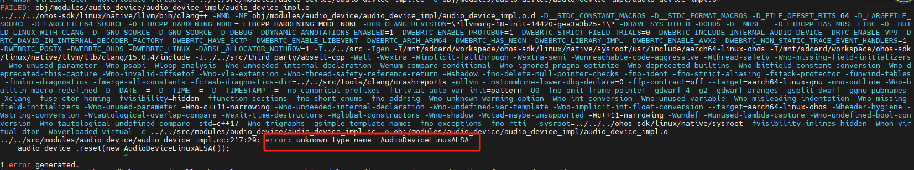
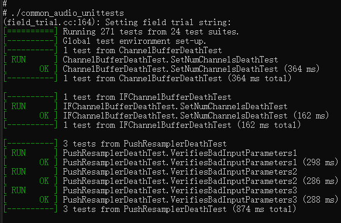
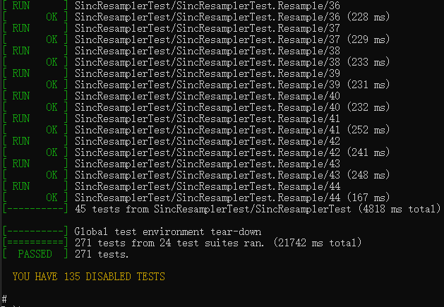

# WebRTC适配OpenHarmony应用端SDK指导

## 简介

WebRTC (Web Real-Time Communications) 是一项实时通讯技术，它允许网络应用或者站点，在不借助中间媒介的情况下，建立浏览器之间点对点（Peer-to-Peer）的连接，实现视频流和（或）音频流或者其他任意数据的传输。接下来讲解如何能将webRTC适配到OpenHarmony系统上。

## 编译前准备

### 编译环境

- ubuntu 20.04.1
- webrtc版本（m109，branch/5414, commitid:4e8a5ac68e8a4ae0588f54f2fdb8cbd1eb5fa50d）
- OpenHarmony SDK版本(5.0.0.68)

### 源码准备

- 安装depot_tools

  创建工作目录webrtc，cd  到自己创建的工作目录，拉取工具：

  ```shell
  # mkdir webrtc
  # cd webrtc
  # git clone https://chromium.googlesource.com/chromium/tools/depot_tools.git
  ```

  成功后，将工具路径添加到环境变量中：

  ```shell
  #vi ~/.bashrc                                    # 在.bashrc文件的最后添加下面一行代码
  #export PATH="$PATH:/xxx/webrtc/depot_tools"     # 路径一定要是绝对路径


  #source ~/.bashrc                                # 配置完环境变量后使环境变量生效
  ```

- 获取代码
  
  ```shell
  #mkdir code （/xxx/webrtc/code）
  #cd code
  #fetch --nohooks webrtc
  ```

  中间如果报错，出现中断，执行： gclient sync 继续下载。没有报错，下载完后也执行一下  gclient sync。

  以上操作是下载最新全量的版本，需切换到指定的版本(m120版本对应的分支为: branch-heads/6099)：

  ```shell
  cd src 
  # git checkout branch-heads/5414    # 切到对应的分支
  # gclient sync                      # 同步分支代码
  ```

  切完分支后可以查看对应的log：

  ```shell
  # git log       # 执行git log命令，以下为对应log信息
  commit 4e8a5ac68e8a4ae0588f54f2fdb8cbd1eb5fa50d (HEAD, branch-heads/5414)
  Author: Tommi <tommi@webrtc.org>
  Date:   Sun Dec 11 13:04:40 2022 +0100
  ...
  ```

- 安装依赖
  
  ```shell
  # cd src
  # ./build/install-build-deps.sh
  ```

- OpenHarmony SDK获取

  我们可以从openHarmony SDK [官方发布渠道](https://gitee.com/openharmony-sig/oh-inner-release-management/blob/master/Release-Testing-Version.md)获取对应版本的SDK，也可以从社区发布对应4.0版本获取对应的SDK，如 [OpenHarmony 4.0 Release](https://gitee.com/openharmony/docs/blob/master/zh-cn/release-notes/OpenHarmony-v4.0-release.md#%E4%BB%8E%E9%95%9C%E5%83%8F%E7%AB%99%E7%82%B9%E8%8E%B7%E5%8F%96)。

### 源码修改

**1. 添加OHOS平台**

```shell
diff -Naur src/build/config/BUILDCONFIG.gn src_ohos/build/config/BUILDCONFIG.gn
--- src/build/config/BUILDCONFIG.gn	2024-10-24 09:22:02.223442391 +0800
+++ src_ohos/build/config/BUILDCONFIG.gn	2024-10-24 14:05:49.277571954 +0800
@@ -235,6 +235,8 @@
 if (target_os == "android") {
   assert(host_os == "linux", "Android builds are only supported on Linux.")
   _default_toolchain = "//build/toolchain/android:android_clang_$target_cpu"
+} else if (target_os == "ohos") {  # OHOS-LOCAL
+  _default_toolchain = "//build/toolchain/ohos:ohos_clang_$target_cpu"
 } else if (target_os == "chromeos" || target_os == "linux") {
   # See comments in build/toolchain/cros/BUILD.gn about board compiles.
   if (is_clang) {
@@ -298,6 +300,7 @@
 # aix or one of the BSDs. If you need to check these, just check the
 # current_os value directly.
 
+is_ohos = current_os == "ohos"
 is_android = current_os == "android"
 is_chromeos = current_os == "chromeos"
 is_fuchsia = current_os == "fuchsia"
@@ -381,6 +384,10 @@
       [ "//build/config/android:default_orderfile_instrumentation" ]
 }
 
+if (is_ohos) {
+  default_compiler_configs += [ "//build/config/ohos:compiler" ]
+}
+
 if (is_clang && !is_nacl) {
   default_compiler_configs += [
     "//build/config/clang:find_bad_constructs",
```

**2. 设置ohos平台clang 工具链相关路径**

```shell
diff -Naur src/build/config/clang/clang.gni src_ohos/build/config/clang/clang.gni
--- src/build/config/clang/clang.gni	2024-10-24 09:22:02.253193770 +0800
+++ src_ohos/build/config/clang/clang.gni	2024-10-24 14:07:45.506620083 +0800
@@ -6,13 +6,25 @@
 
 default_clang_base_path = "//third_party/llvm-build/Release+Asserts"
 
+if (is_ohos) {
+    declare_args() {
+        ohos_sdk_native_root = "//buildtools/ohos-sdk/linux/native"
+    }
+    default_clang_base_path = "${ohos_sdk_native_root}/llvm"
+    clang_lib_path = "${default_clang_base_path}/lib"
+}
+
 declare_args() {
   # Indicates if the build should use the Chrome-specific plugins for enforcing
   # coding guidelines, etc. Only used when compiling with Chrome's Clang, not
   # Chrome OS's.
-  clang_use_chrome_plugins =
-      is_clang && !is_nacl && current_os != "zos" &&
-      default_toolchain != "//build/toolchain/cros:target"
+   if (is_ohos) {
+    clang_use_chrome_plugins = false
+  } else {
+    clang_use_chrome_plugins =
+        is_clang && !is_nacl && current_os != "zos" &&
+        default_toolchain != "//build/toolchain/cros:target"
+  }
 
   clang_base_path = default_clang_base_path
 }
```

**特别声明：此处`ohos_sdk_native_root`配置默认的路径，用户需将ohos的SDK拷贝到buildtools目录，且目录需要和配置的保持一致，或者可以在编译时手动配置ohos sdk路径**

**3. 设置ohos平台的sysroot**

```shell
diff -Naur src/build/config/sysroot.gni src_ohos/build/config/sysroot.gni
--- src/build/config/sysroot.gni	2024-10-24 09:22:02.337489344 +0800
+++ src_ohos/build/config/sysroot.gni	2024-10-24 14:08:53.731491294 +0800
@@ -33,6 +33,9 @@
 
     # Android uses unified headers, and thus a single compile time sysroot
     sysroot = "$android_toolchain_root/sysroot"
+  } else if (is_ohos) {
+    import("//build/config/clang/clang.gni")
+    sysroot = "${ohos_sdk_native_root}/sysroot"
   } else if ((is_linux || is_chromeos) && use_sysroot) {
     # By default build against a sysroot image downloaded from Cloud Storage
     # during gclient runhooks.
```

**4. 设置ohos平台clang版本**

```shell
diff -Naur src/build/toolchain/toolchain.gni src_ohos/build/toolchain/toolchain.gni
--- src/build/toolchain/toolchain.gni	2024-10-24 09:22:02.457486573 +0800
+++ src_ohos/build/toolchain/toolchain.gni	2024-10-24 14:10:30.133633570 +0800
@@ -33,7 +33,11 @@
 }
 
 declare_args() {
-  clang_version = "16.0.0"
+  if (is_ohos) {
+    clang_version = "15.0.4"
+  } else {
+    clang_version = "16.0.0"
+  }
 }
 
 # Extension for shared library files (including leading dot).
```

**5. 扩充原本的gcc_toolchain模板功能**

这里主要是添加了ohos的用于启动引导程序的.o，gcc_toolchain.gni中template("single_gcc_toolchain")添加这几个参数的识别：

```shell
diff -Naur src/build/toolchain/gcc_toolchain.gni src_ohos/build/toolchain/gcc_toolchain.gni
--- src/build/toolchain/gcc_toolchain.gni	2024-10-24 09:22:02.451536297 +0800
+++ src_ohos/build/toolchain/gcc_toolchain.gni	2024-10-24 14:37:10.727901585 +0800
@@ -122,6 +122,30 @@
       rebuild_string = ""
     }
 
+    if (defined(invoker.libs_section_prefix)) {
+      libs_section_prefix = invoker.libs_section_prefix
+    } else {
+      libs_section_prefix = ""
+    }
+
+    if (defined(invoker.libs_section_postfix)) {
+      libs_section_postfix = invoker.libs_section_postfix
+    } else {
+      libs_section_postfix = ""
+    }
+
+    if (defined(invoker.solink_libs_section_prefix)) {
+      solink_libs_section_prefix = invoker.solink_libs_section_prefix
+    } else {
+      solink_libs_section_prefix = ""
+    }
+
+    if (defined(invoker.solink_libs_section_postfix)) {
+      solink_libs_section_postfix = invoker.solink_libs_section_postfix
+    } else {
+      solink_libs_section_postfix = ""
+    }
+
```

修改tool("solink")和tool("solink_module")中rspfile_content：

```shell
@@ -487,7 +511,7 @@
         # ld.
         rspfile_content = "{{inputs}} {{solibs}} {{libs}} {{rlibs}}"
       } else {
-        rspfile_content = "-Wl,--whole-archive {{inputs}} {{solibs}} -Wl,--no-whole-archive {{libs}} -Wl,--whole-archive {{rlibs}} -Wl,--no-whole-archive"
+        rspfile_content = "-Wl,--whole-archive {{inputs}} {{solibs}} -Wl,--no-whole-archive $solink_libs_section_prefix {{libs}} $solink_libs_section_postfix"
       }
 
       description = "SOLINK $sofile"
@@ -565,7 +589,7 @@
         strip_command = "${invoker.strip} -o \"$sofile\" \"$unstripped_sofile\""
         command += " && " + strip_command
       }
-      rspfile_content = "$whole_archive_flag {{inputs}} {{solibs}} $no_whole_archive_flag {{libs}} $whole_archive_flag {{rlibs}} $no_whole_archive_flag"
+      rspfile_content = "-Wl,--whole-archive {{inputs}} {{solibs}} -Wl,--no-whole-archive $solink_libs_section_prefix {{libs}} $solink_libs_section_postfix"
 
       description = "SOLINK_MODULE $sofile"
```

修改tool("link")中link_command：

```shell
@@ -618,7 +642,7 @@
         start_group_flag = "-Wl,--start-group"
         end_group_flag = "-Wl,--end-group "
       }
-      link_command = "$ld {{ldflags}}${extra_ldflags} -o \"$unstripped_outfile\" $start_group_flag @\"$rspfile\" {{solibs}} $end_group_flag {{libs}}"
+      link_command = "$ld {{ldflags}}${extra_ldflags} -o \"$unstripped_outfile\" $libs_section_prefix $start_group_flag @\"$rspfile\" {{solibs}} {{libs}} $end_group_flag  $libs_section_postfix"
```

**6. 设置各个架构的ohos_clang_toolchain**

新建build/toolchain/ohos/BUILD.gn

```shell
import("//build/config/sysroot.gni")
import("//build/toolchain/gcc_toolchain.gni")

declare_args() {
  # Whether unstripped binaries, i.e. compiled with debug symbols, should be
  # considered runtime_deps rather than stripped ones.
  ohos_unstripped_runtime_outputs = true
  ohos_extra_cflags = ""
  ohos_extra_cppflags = ""
  ohos_extra_cxxflags = ""
  ohos_extra_asmflags = ""
  ohos_extra_ldflags = ""
}

# The ohos clang toolchains share most of the same parameters, so we have this
# wrapper around gcc_toolchain to avoid duplication of logic.
#
# Parameters:
#  - toolchain_root
#      Path to cpu-specific toolchain within the ndk.
#  - sysroot
#      Sysroot for this architecture.
#  - lib_dir
#      Subdirectory inside of sysroot where libs go.
#  - binary_prefix
#      Prefix of compiler executables.
template("ohos_clang_toolchain") {
  gcc_toolchain(target_name) {
    assert(defined(invoker.toolchain_args),
           "toolchain_args must be defined for ohos_clang_toolchain()")
    toolchain_args = invoker.toolchain_args
    toolchain_args.current_os = "ohos"

    # Output linker map files for binary size analysis.
    enable_linker_map = true

    ohos_libc_dir =
        rebase_path(invoker.sysroot + "/" + invoker.lib_dir, root_build_dir)
 #   libs_section_prefix = "${ohos_libc_dir}/Scrt1.o"
 #   libs_section_prefix += " ${ohos_libc_dir}/crti.o"
 #   libs_section_postfix = "${ohos_libc_dir}/crtn.o"

    if (invoker.target_name == "ohos_clang_arm") {
      abi_target = "arm-linux-ohos"
    } else if (invoker.target_name == "ohos_clang_arm64") {
      abi_target = "aarch64-linux-ohos"
    } else if (invoker.target_name == "ohos_clang_x86_64") {
      abi_target = "x86_64-linux-ohos"
    }

    clang_rt_dir =
        rebase_path("${clang_lib_path}/${abi_target}/nanlegacy",
                    root_build_dir)
    print("ohos_libc_dir :", ohos_libc_dir)
    print("clang_rt_dir :", clang_rt_dir)
#    solink_libs_section_prefix = "${ohos_libc_dir}/crti.o"
#    solink_libs_section_prefix += " ${clang_rt_dir}/clang_rt.crtbegin.o"
#    solink_libs_section_postfix = "${ohos_libc_dir}/crtn.o"
#    solink_libs_section_postfix += " ${clang_rt_dir}/clang_rt.crtend.o"

    _prefix = rebase_path("${clang_base_path}/bin", root_build_dir)
    cc = "${_prefix}/clang"
    cxx = "${_prefix}/clang++"
    ar = "${_prefix}/llvm-ar"
    ld = cxx
    readelf = "${_prefix}/llvm-readobj"
    nm = "${_prefix}/llvm-nm"
    if (!is_debug) {
      strip = rebase_path("${clang_base_path}/bin/llvm-strip", root_build_dir)
      use_unstripped_as_runtime_outputs = ohos_unstripped_runtime_outputs
    }
    extra_cflags = ohos_extra_cflags
    extra_cppflags = ohos_extra_cppflags
    extra_cxxflags = ohos_extra_cxxflags
    extra_asmflags = ohos_extra_asmflags
    extra_ldflags = ohos_extra_ldflags
  }
}


ohos_clang_toolchain("ohos_clang_arm") {
  sysroot = "${sysroot}"
  lib_dir = "usr/lib/arm-linux-ohos"
  toolchain_args = {
    current_cpu = "arm"
  }
}

ohos_clang_toolchain("ohos_clang_arm64") {
  sysroot = "${sysroot}"
  lib_dir = "usr/lib/aarch64-linux-ohos"
  toolchain_args = {
    current_cpu = "arm64"
  }
}

ohos_clang_toolchain("ohos_clang_x86_64") {
  sysroot = "${sysroot}"
  lib_dir = "usr/lib/x86_64-linux-ohos"
  toolchain_args = {
    current_cpu = "x86_64"
  }
}

```

**7. 设置ohos的一些编译参数，将其加入到BUILDCONFIG.gn中**

新建build/config/ohos/BUILD.gn,该文件主要是定义一个config，该config会被注册到所有的编译目标，该config主要设置了基础的编译选项、宏定义等:

```shell

import("//build/config/sysroot.gni")
import("//build/config/clang/clang.gni")
assert(is_ohos)

ohos_clang_base_path = "${ohos_sdk_native_root}/llvm"
ohos_clang_version = "15.0.4"

if (is_ohos) {
  if (current_cpu == "arm") {
    abi_target = "arm-linux-ohos"
  } else if (current_cpu == "x86") {
    abi_target = ""
  } else if (current_cpu == "arm64") {
    abi_target = "aarch64-linux-ohos"
  } else if (current_cpu == "x86_64") {
    abi_target = "x86_64-linux-ohos"
  } else {
    assert(false, "Architecture not supported")
  }
}


config("compiler") {
  cflags = [
    "-ffunction-sections",
    "-fno-short-enums",
    "-fno-addrsig",
  ]

  cflags += [
    "-Wno-unknown-warning-option",
    "-Wno-int-conversion",
    "-Wno-unused-variable",
    "-Wno-misleading-indentation",
    "-Wno-missing-field-initializers",
    "-Wno-unused-parameter",
    "-Wno-c++11-narrowing",
    "-Wno-unneeded-internal-declaration",
    "-Wno-undefined-var-template",
    "-Wno-implicit-int-float-conversion",
  ]
  defines = [
    # The NDK has these things, but doesn't define the constants to say that it
    # does. Define them here instead.
    "HAVE_SYS_UIO_H",
  ]

  defines += [
    "OHOS",
    "__MUSL__",
    "_LIBCPP_HAS_MUSL_LIBC",
    "__BUILD_LINUX_WITH_CLANG",
    "__GNU_SOURCE",
    "_GNU_SOURCE",
  ]

  ldflags = [
    "-Wl,--no-undefined",
    "-Wl,--exclude-libs=libunwind_llvm.a",
    "-Wl,--exclude-libs=libc++_static.a",

    # Don't allow visible symbols from libraries that contain
    # assembly code with symbols that aren't hidden properly.
    # http://crbug.com/448386
    "-Wl,--exclude-libs=libvpx_assembly_arm.a",
  ]

  cflags += [ "--target=$abi_target" ]
  include_dirs = [
    "${sysroot}/usr/include/${abi_target}",
    "${ohos_clang_base_path}/lib/clang/${ohos_clang_version}/include",
  ]

  ldflags += [ "--target=$abi_target" ]

  # Assign any flags set for the C compiler to asmflags so that they are sent
  # to the assembler.
  asmflags = cflags
}

```

**8. build/config/compiler/BUILD.gn 增加对is_ohos得判断**

```shell
@@ -1334,9 +1334,13 @@
 config("clang_revision") {
   if (is_clang && clang_base_path == default_clang_base_path) {
     update_args = [
-      "--print-revision",
-      "--verify-version=$clang_version",
+      "--print-revision"
     ]
+
+    if (!is_ohos) {
+      update_args += [ "--verify-version=$clang_version" ]
+    }
+
     if (llvm_force_head_revision) {
       update_args += [ "--llvm-force-head-revision" ]
     }
```

为了避免编译中出现因警告而造成出错，需要将`-Werror`去掉

```shell
@@ -1643,12 +1647,12 @@
   } else {
     cflags = [ "-Wall" ]
     if (treat_warnings_as_errors) {
-      cflags += [ "-Werror" ]
+     # cflags += [ "-Werror" ]
 
       # The compiler driver can sometimes (rarely) emit warnings before calling
       # the actual linker.  Make sure these warnings are treated as errors as
       # well.
-      ldflags = [ "-Werror" ]
+     # ldflags = [ "-Werror" ]
     }
     if (is_clang) {
       # Enable extra warnings for chromium_code when we control the compiler.
@@ -1732,8 +1736,8 @@
     # GCC may emit unsuppressible warnings so don't add -Werror for no chromium
     # code. crbug.com/589724
     if (treat_warnings_as_errors && is_clang) {
-      cflags += [ "-Werror" ]
-      ldflags = [ "-Werror" ]
+     # cflags += [ "-Werror" ]
+     # ldflags = [ "-Werror" ]
     }
     if (is_clang && !is_nacl) {
       # TODO(thakis): Remove !is_nacl once
```

编译过程中会提示部分配置不识别，因此也需要将这些配置项删除：

```shell
@@ -530,14 +530,14 @@
     # TODO(hans): Remove this once Clang generates better optimized debug info
     # by default. https://crbug.com/765793
     cflags += [
-      "-mllvm",
-      "-instcombine-lower-dbg-declare=0",
+    #  "-mllvm",
+    #  "-instcombine-lower-dbg-declare=0",
     ]
     if (!is_debug && use_thin_lto && is_a_target_toolchain) {
       if (is_win) {
         ldflags += [ "-mllvm:-instcombine-lower-dbg-declare=0" ]
       } else {
-        ldflags += [ "-Wl,-mllvm,-instcombine-lower-dbg-declare=0" ]
+      #  ldflags += [ "-Wl,-mllvm,-instcombine-lower-dbg-declare=0" ]
       }
     }
 
@@ -703,7 +703,7 @@
         import_instr_limit = 5
       }
 
-      ldflags += [ "-Wl,-mllvm,-import-instr-limit=$import_instr_limit" ]
+      # ldflags += [ "-Wl,-mllvm,-import-instr-limit=$import_instr_limit" ]
     }
 
     # TODO(https://crbug.com/1211155): investigate why this isn't effective on

@@ -2082,8 +2091,8 @@
 
       if (use_ml_inliner && is_a_target_toolchain) {
         cflags += [
-          "-mllvm",
-          "-enable-ml-inliner=release",
+        #  "-mllvm",
+        #  "-enable-ml-inliner=release",
         ]
       }
     } else {
```

**9. build/config/clang/BUILD.gn 删除不支持的选项**

```shell
diff -Naur src/build/config/clang/BUILD.gn src_ohos/build/config/clang/BUILD.gn
--- src/build/config/clang/BUILD.gn	2024-10-24 09:22:02.252202058 +0800
+++ src_ohos/build/config/clang/BUILD.gn	2024-10-24 14:55:59.145429642 +0800
@@ -11,15 +11,15 @@
     # The plugin is built directly into clang, so there's no need to load it
     # dynamically.
     cflags += [
-      "-Xclang",
-      "-add-plugin",
-      "-Xclang",
-      "find-bad-constructs",
-
-      "-Xclang",
-      "-plugin-arg-find-bad-constructs",
-      "-Xclang",
-      "raw-ref-template-as-trivial-member",
+    #  "-Xclang",
+    #  "-add-plugin",
+    #  "-Xclang",
+    #  "find-bad-constructs",
+
+    #  "-Xclang",
+    #  "-plugin-arg-find-bad-constructs",
+    #  "-Xclang",
+    #  "raw-ref-template-as-trivial-member",
     ]
 
     if (is_linux || is_chromeos || is_android || is_fuchsia) {
@@ -37,12 +37,12 @@
 # compile with these so may want to remove this config.
 config("extra_warnings") {
   cflags = [
-    "-Wheader-hygiene",
+  #  "-Wheader-hygiene",
 
     # Warns when a const char[] is converted to bool.
-    "-Wstring-conversion",
+  #  "-Wstring-conversion",
 
-    "-Wtautological-overlap-compare",
+  #  "-Wtautological-overlap-compare",
   ]
 }
```

**10. 其他业务代码修改**

- 一些三方库没有适配ohos，可以走linux的文件，如不修改会提示部分接口找不到
  
  1. 修改libevent中的BUILD.gn

  ```shell
  diff -Naur src/third_party/libevent/BUILD.gn src_ohos/third_party/libevent/BUILD.gn
  --- src/third_party/libevent/BUILD.gn	2024-10-24 09:22:25.466802965 +0800
  +++ src_ohos/third_party/libevent/BUILD.gn	2024-10-24 14:57:37.673306420 +0800
  @@ -43,13 +43,13 @@
         "mac/event-config.h",
       ]
       include_dirs = [ "mac" ]
  -  } else if (is_linux || is_chromeos) {
  +  } else if (is_linux || is_chromeos || is_ohos) {
       sources += [
         "epoll.c",
         "linux/config.h",
         "linux/event-config.h",
       ]
  -    include_dirs = [ "linux" ]
  +    include_dirs = [ "linux", "compat" ]
     } else if (is_android) {
       sources += [
         "android/config.h",
  ```

  2. 修改video_capture的BUILD.gn

  ```shell
  diff -Naur src/modules/video_capture/BUILD.gn src_ohos/modules/video_capture/BUILD.gn
  --- src/modules/video_capture/BUILD.gn	2024-10-24 10:06:45.106063829 +0800
  +++ src_ohos/modules/video_capture/BUILD.gn	2024-10-24 15:10:49.503095752 +0800
  @@ -62,7 +62,7 @@
         "../../system_wrappers",
       ]
 
  -    if (is_linux || is_chromeos) {
  +    if (is_linux || is_chromeos || is_ohos) {
         sources = [
           "linux/device_info_linux.cc",
           "linux/device_info_v4l2.cc",
  ```
  
  3. 修改zlib的BUILD.gn

   ```shell
   diff -Naur src/third_party/zlib/BUILD.gn src_ohos/third_party/zlib/BUILD.gn
   --- src/third_party/zlib/BUILD.gn	2024-10-24 09:22:32.935042341 +0800
   +++ src_ohos/third_party/zlib/BUILD.gn	2024-10-24 15:12:16.479317436 +0800
   @@ -121,7 +121,7 @@
         defines = [ "CRC32_ARMV8_CRC32" ]
         if (is_android) {
           defines += [ "ARMV8_OS_ANDROID" ]
   -      } else if (is_linux || is_chromeos) {
   +      } else if (is_linux || is_chromeos || is_ohos) {
            defines += [ "ARMV8_OS_LINUX" ]
          } else if (is_mac) {
            defines += [ "ARMV8_OS_MACOS" ]
  
   ```

- 修改当前项目中不支持ohos的接口
  
  1. `rtc_base/platform_thread_types.cc`需要识别到ohos然后调用`gettid()`
  
  首先需要在根目录的BUILD.gn中配置识别ohos系统的变量：

  ```shell
  diff -Naur src/BUILD.gn src_ohos/BUILD.gn
  --- src/BUILD.gn	2024-10-24 10:06:44.716202585 +0800
  +++ src_ohos/BUILD.gn	2024-10-24 15:14:40.329478789 +0800
  @@ -205,6 +205,9 @@
         "WEBRTC_IOS",
       ]
     }
  +  if (is_ohos) {
  +    defines += [ "WEBRTC_OHOS", "WEBRTC_LINUX" ]
  +  }
     if (is_linux || is_chromeos) {
       defines += [ "WEBRTC_LINUX" ]
     }
  ```

  当前很多业务模块还未进行识别，暂时走linux分支。具体模块需要用户进行分析。

  修改rtc_base/platform_thread_types.c业务代码：
  
  ```shell
  --- src/rtc_base/platform_thread_types.cc	2023-12-15 19:42:56.000000000 -0800
  +++ src_ohos/rtc_base/platform_thread_types.cc	2023-12-18 00:42:49.393883643 -0800
  @@ -40,7 +40,7 @@ PlatformThreadId CurrentThreadId() {
   #elif defined(WEBRTC_POSIX)
   #if defined(WEBRTC_MAC) || defined(WEBRTC_IOS)
     return pthread_mach_thread_np(pthread_self());
  -#elif defined(WEBRTC_ANDROID)
  +#elif defined(WEBRTC_ANDROID) || defined(WEBRTC_OHOS)
     return gettid();
   #elif defined(WEBRTC_FUCHSIA)
     return zx_thread_self();
  ```

  当前ohos支持的函数接口为`gettid()`，因此我们可以将`WEBRTC_OHOS`判断和`WEBRTC_ANDROID`放在一起，也可以单独建一个分支，单独建分支时需要注意，其判断需要放在`WEBRTC_LINUX`之前。

  2. 屏蔽`third_party/dav1d`中不支持的接口`pthread_getaffinity_np`
  
  通过分析可知，`pthread_getaffinity_np`接口是在宏`HAVE_PTHREAD_GETAFFINITY_NP`生效时调用，故我们只需要将该宏在ohos平台时设置为不生效即可：

  ```shell
  --- src/third_party/dav1d/BUILD.gn	2023-12-15 21:08:22.000000000 -0800
  +++ src_ohos/third_party/dav1d/BUILD.gn	2023-12-18 17:39:15.988668172 -0800
  @@ -56,7 +56,7 @@ config("public_dav1d_config") {
       defines = [ "CONFIG_LOG=1" ]
     }
   
  -  if (!is_android && !is_win) {
  +  if (!is_android && !is_win && !is_ohos) {
       defines += [
         "HAVE_PTHREAD_GETAFFINITY_NP=1",
         "HAVE_PTHREAD_SETAFFINITY_NP=1",
  ```

[完整的patch文件](./ohos.patch)

## 编译

做完以上修改后，我们就可以进行编译了，默认的编译命令：

```shell
gn gen ../out/ohos_webrtc --args='is_clang=true target_cpu="arm64" target_os="ohos"'    # 通过gn生成对应的ninja文件
ninja -C ../out/ohos_webrtc -v -j32                                                     # 使用ninja进行编译
```

执行默认的编译命令后会出现以下问题：

1. 问题一：提示音频采集/解码接口找不到



通过分析代码可,该错误是在编译audio_device时出得错误，而当前webrtc已适配了android, linux, mac以及win几种平台，没有适配ohos平台，但我们也可以看到，如果将`rtc_use_dummy_audio_file_devices`该变量置起，其默认不会编audio_device相关得代码，当前可以在执行gn配置时加上参数`rtc_use_dummy_audio_file_devices=true`进行规避操作。

通过以上分析，最终的编译命令如下：

```shell
gn gen ../out/ohos_webrtc --args='is_clang=true target_cpu="arm64" target_os="ohos" rtc_use_dummy_audio_file_devices=true ohos_sdk_native_root="/owner/workspace/sdk-linux-4.1.3.500/sdk/HarmonyOS-NEXT-DP1/base/native/"'    # out目录根据实际情况设置,ohos_sdk_native_root需要配置成自己SDK的路径，配置到native目录。
ninja -C ../out/ohos_webrtc -v -j32                 # -v 查看编译的具体过程， -j32使用32个线程进行编译，提升编译速度
```

## 测试验证

按照当前步骤编译完后会生成很多测试用例，当前以`common_audio_unittests`用例上板测试验证，将`common_audio_unittests`推送到板子，后然后运行测试，效果如下图：




## 编译/使用中遇到问题总结

[常见问题总结](./webrtc_adapter_questions.md)
