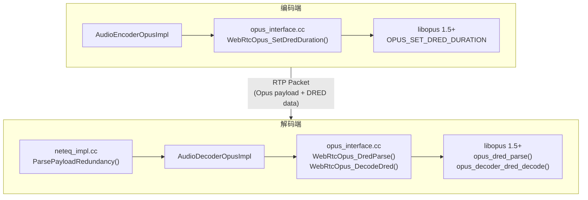

---

name: Opus DRED Integration
overview: 将 Opus 1.5+/1.6 的 DRED (Deep REDundancy) 功能集成到当前 WebRTC 项目中，参考 xiph/webrtc-opus-ng 的 opus-ng 分支实现。DRED 利用深度学习对音频进行冗余编码，在高丢包场景下显著提升音质恢复能力。
todos:

- id: branch
content: 从 feature/audio-network-lab 新建 feature/opus-dred 分支
status: pending
- id: upgrade-opus
content: 升级 third_party/opus/src 到 Opus 1.5+ 或 1.6，确保包含 dnn/ 目录和 DRED API
status: pending
- id: build-opus
content: 更新 third_party/opus/BUILD.gn，编译新增的 dnn/ 源文件，添加 DRED 编译宏
status: pending
- id: opus-inst
content: 修改 opus_inst.h，在 WebRtcOpusDecInst 中添加 OpusDREDDecoder 指针
status: pending
- id: opus-interface
content: 修改 opus_interface.h/cc，添加 DRED 相关 C API 包装函数
status: pending
- id: audio-decoder-base
content: 修改 api/audio_codecs/audio_decoder.h/cc，添加 DRED 相关虚函数接口
status: pending
- id: audio-decoder-opus
content: 修改 audio_decoder_opus.h/cc，实现 DRED 解码和 ParsePayloadRedundancy
status: pending
- id: encoder-config
content: 修改 audio_encoder_opus_config.h，添加 dred 配置字段
status: pending
- id: encoder-impl
content: 修改 audio_encoder_opus.cc，在编码器初始化时配置 DRED duration
status: pending
- id: neteq-integration
content: 修改 neteq_impl.cc，用 ParsePayloadRedundancy 替换 ParsePayload 以支持 DRED 恢复帧注入
status: pending
- id: test-verify
content: 编译验证并用 audio_network_lab 测试 DRED 丢包恢复效果
status: pending
isProject: false

---

# Opus DRED (Deep REDundancy) 功能集成计划

> **实施状态**：以下 11 个 todo 均已落地完成，具体变更散布在
> `api/audio_codecs/`、`modules/audio_coding/codecs/opus/`、
> `modules/audio_coding/neteq/` 以及 `third_party/opus/`（后者通过
> `tools_webrtc/opus_dred/setup_opus_dred.py` 在本地重建）。
> 新人跑完 `gclient sync` 后执行
> `python3 tools_webrtc/opus_dred/setup_opus_dred.py`
> 即可获得可编译的 DRED 环境。

## 背景

DRED 是 Opus 1.5+ 引入的特性，使用 DNN (Deep Neural Network) 对音频帧进行冗余编码。编码端将 DRED 数据附加在 Opus 包尾部，解码端在丢包时可利用后续包中的 DRED 数据恢复丢失帧，恢复质量远优于传统 PLC 和 LBRR FEC。

参考实现：[xiph/webrtc-opus-ng `opus-ng` 分支](https://github.com/xiph/webrtc-opus-ng/tree/opus-ng)

## 当前状态

- 当前分支：`feature/audio-network-lab`
- 当前 Opus 版本：pre-1.5（`third_party/opus/src/` 中**没有** `dnn/` 目录，`opus.h` 中无任何 DRED API）
- 当前代码库中不存在任何 DRED 相关代码或编译宏 (`WEBRTC_OPUS_SUPPORT_DRED`, `WEBRTC_OPUS_USE_CODEC_PLC`)

## 总体架构




## 分层改动

### 第 0 层：升级 Opus 库到 1.5+

这是最关键的前置步骤。当前 `third_party/opus/src/` 缺少 DRED 所需的全部 API：

需要的新 API（Opus 1.5+ 提供）：

- `OpusDREDDecoder` 类型
- `opus_dred_decoder_create()` / `opus_dred_decoder_destroy()`
- `opus_dred_parse()` / `opus_dred_get_size()`
- `opus_decoder_dred_decode()`
- `OPUS_SET_DRED_DURATION` / `OPUS_GET_DRED_DURATION` CTLs
- `dnn/` 模块（DRED 的神经网络核心）

**方案**：将 `third_party/opus/src/` 替换为 opus 1.5+ 或 1.6 release，同时确保 [third_party/opus/BUILD.gn](third_party/opus/BUILD.gn) 中正确编译新增的 `dnn/` 源文件，并加入 `WEBRTC_OPUS_SUPPORT_DRED=1` 和 `WEBRTC_OPUS_USE_CODEC_PLC=1` 编译宏。

### 第 1 层：`opus_inst.h` - 解码器实例结构

文件：[modules/audio_coding/codecs/opus/opus_inst.h](modules/audio_coding/codecs/opus/opus_inst.h)

在 `WebRtcOpusDecInst` 中添加 DRED 解码器指针：

```cpp
struct WebRtcOpusDecInst {
  OpusDecoder* decoder;
  OpusMSDecoder* multistream_decoder;
  OpusDREDDecoder *dred_decoder;   // 新增
  // ... 其余成员不变
};
```

### 第 2 层：`opus_interface.h/cc` - C API 包装

文件：[modules/audio_coding/codecs/opus/opus_interface.h](modules/audio_coding/codecs/opus/opus_interface.h) / [opus_interface.cc](modules/audio_coding/codecs/opus/opus_interface.cc)

新增函数：

- `WebRtcOpus_SetDredDuration(inst, duration)` -- 设置编码器 DRED 时长（10ms 帧数）
- `WebRtcOpus_GetDredDuration(inst)` -- 获取编码器 DRED 配置
- `WebRtcOpus_DecodeDred(inst, dred_data, decoded, offset)` -- 解码 DRED 的某个 10ms 片段
- `WebRtcOpus_DredParse(inst, dred_data, encoded, length, max_samples, dred_end)` -- 从编码包中解析 DRED 数据

修改函数：

- `WebRtcOpus_DecoderCreate()` -- 同时创建 `opus_dred_decoder_create()`，条件编译（`WEBRTC_OPUS_SUPPORT_DRED`）设置解码器 complexity
- `WebRtcOpus_DecoderFree()` -- 同时销毁 `opus_dred_decoder_destroy()`

### 第 3 层：`audio_decoder.h/cc` - 基类 AudioDecoder

文件：[api/audio_codecs/audio_decoder.h](api/audio_codecs/audio_decoder.h) / [api/audio_codecs/audio_decoder.cc](api/audio_codecs/audio_decoder.cc)

新增接口：

- `virtual ParsePayloadRedundancy(payload, timestamp, recovery_timestamp_offset)` -- 带 DRED 恢复偏移的 payload 解析
- `int DecodeDred(encoded, encoded_len, primary_timestamp, decoded, index)` -- 公有 DRED 解码入口
- `virtual int DecodeDredInternal(...)` -- 受保护虚函数，供子类实现

### 第 4 层：`audio_decoder_opus.h/cc` - Opus 解码器实现

文件：[modules/audio_coding/codecs/opus/audio_decoder_opus.h](modules/audio_coding/codecs/opus/audio_decoder_opus.h) / [audio_decoder_opus.cc](modules/audio_coding/codecs/opus/audio_decoder_opus.cc)

新增/重写方法：

- `ParsePayloadRedundancy()` -- 核心逻辑：解析 FEC + 调用 `WebRtcOpus_DredParse()` 提取 DRED 数据，生成多个 priority=2 的恢复帧（优先级低于 FEC 的 priority=1）
- `GeneratePlc()` -- 条件编译使用 Opus 内建 PLC (`WEBRTC_OPUS_USE_CODEC_PLC`)
- `DecodeDredInternal()` -- 调用 `WebRtcOpus_DecodeDred()` 解码单个 DRED 片段

DRED 恢复帧使用 `OpusFrame` 封装，携带 `CopyOnWriteBuffer` 形式的 DRED 数据和偏移索引。

### 第 5 层：`audio_encoder_opus_config.h` - 编码器配置

文件：[api/audio_codecs/opus/audio_encoder_opus_config.h](api/audio_codecs/opus/audio_encoder_opus_config.h)

新增字段：

```cpp
int dred;  // DRED 冗余帧数量（10ms 单位），0=禁用
```

### 第 6 层：`audio_encoder_opus.cc` - 编码器实现

文件：[modules/audio_coding/codecs/opus/audio_encoder_opus.cc](modules/audio_coding/codecs/opus/audio_encoder_opus.cc)

在 `RecreateEncoderInstance()` 中，当 `config.dred > 0` 时调用 `WebRtcOpus_SetDredDuration(inst_, config.dred)`。

### 第 7 层：`neteq_impl.cc` - NetEq 集成

文件：`modules/audio_coding/neteq/neteq_impl.cc`

将 `InsertPacketInternal()` 中的 `ParsePayload()` 调用替换为 `ParsePayloadRedundancy()`，传入基于时间戳间隔计算的 `recovery_timestamp_offset`（丢包间隙），使 DRED 恢复帧被注入 PacketBuffer。

### 第 8 层：BUILD.gn 与编译宏

- [third_party/opus/BUILD.gn](third_party/opus/BUILD.gn) -- 添加 `dnn/` 源文件编译规则
- [modules/audio_coding/BUILD.gn](modules/audio_coding/BUILD.gn) -- 添加 `WEBRTC_OPUS_SUPPORT_DRED=1` 和 `WEBRTC_OPUS_USE_CODEC_PLC=1` 编译宏
- 条件编译宏确保在 Opus 版本不支持 DRED 时可以退化为无 DRED 模式

## 风险与注意事项

- Opus 升级可能引入 API/ABI 不兼容，需要仔细验证 BUILD.gn 中已有的 opus 编译规则是否兼容新版本
- DRED 的 DNN 模块需要权重文件和额外计算资源，可能影响 CPU 开销
- opus-ng 分支的代码有一些 TODO 标记（如 `klingm@amazon.com`），说明该集成仍处于实验阶段
- Multistream 编码器/解码器暂不支持 DRED（opus-ng 中也未实现）
- 需要新建分支 `feature/opus-dred` 从当前 `feature/audio-network-lab` 分支切出

