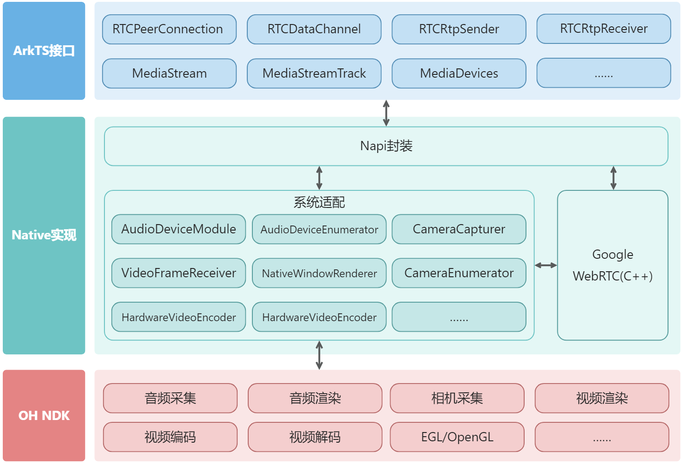

# <center>ohos_webrtc</center>

本项目基于 [WebRTC](https://webrtc.googlesource.com/src) 开发。

## 简介

ohos_webrtc 是适用于 OpenHarmony/HarmonyOS 的实时通信库，提供 ArkTS 接口封装，并在 C++ 层适配了视频采集、渲染及编解码等模块。大部分接口遵循 [WebRTC 规范](https://www.w3.org/TR/webrtc/)，同时额外提供 PeerConnectionFactory 和 AudioDeviceModule 等接口。

**图1** SDK 架构图




## 下载安装

```bash
ohpm install @ohos/webrtc
```

OpenHarmony ohpm 环境配置等更多内容，请参考[如何安装 OpenHarmony ohpm 包](https://gitcode.com/openharmony-tpc/docs/blob/master/OpenHarmony_har_usage.md)。

## 约束与限制

### 兼容性

在下述版本验证通过：

- DevEco Studio: NEXT Beta2(5.0.3.900)，SDK: API12 Release(5.0.0.71)，ROM：5.0.0.71

> **OHOS SDK 要求 API 12 及以上。**

### 权限要求

打开 `entry/src/main/module.json5`，根据实际功能需求添加以下权限：

```json
"requestPermissions": [
  {
    "name": "ohos.permission.MICROPHONE",
    "reason": "$string:microphone_reason",
    "usedScene": {
      "abilities": ["EntryAbility"],
      "when": "inuse"
    }
  },
  {
    "name": "ohos.permission.CAMERA",
    "reason": "$string:camera_reason",
    "usedScene": {
      "abilities": ["EntryAbility"],
      "when": "inuse"
    }
  },
  {
    "name": "ohos.permission.CAPTURE_SCREEN",
    "reason": "$string:screen_capture_reason",
    "usedScene": {
      "abilities": ["EntryAbility"],
      "when": "inuse"
    }
  }
]
```

## 使用示例

以下示例展示了基本的音视频通话建立流程：

```typescript
import webrtc from '@ohos/webrtc';

// 创建 PeerConnectionFactory 实例
let peerConnectionFactory = new webrtc.PeerConnectionFactory();

// 创建本地音频源和音频轨道
let audioSource = peerConnectionFactory.createAudioSource();
let audioTrack = peerConnectionFactory.createAudioTrack('audio', audioSource);

// 创建本地视频源和视频轨道（分辨率 640×480，帧率 15~30fps）
let videoSource = peerConnectionFactory.createVideoSource({
  width: 640,
  height: 480,
  frameRate: { min: 15, max: 30 }
});
let videoTrack = peerConnectionFactory.createVideoTrack('video', videoSource);

// 创建 RTCPeerConnection
let peerConnection = peerConnectionFactory.createPeerConnection({
  iceServers: [{ urls: 'stun:stun.example.com' }]
});

// 添加媒体轨道到连接
peerConnection.addTrack(audioTrack);
peerConnection.addTrack(videoTrack);

// 监听 ICE 候选者
peerConnection.onicecandidate = (event) => {
  if (event.candidate) {
    // 通过信令通道将候选者发送给对端
  }
};

// 创建并设置本地 Offer 描述
let offer = await peerConnection.createOffer();
await peerConnection.setLocalDescription(offer);
// 通过信令通道将 SDP offer 发送给远程端点
```

更多使用示例请查看 `har_hap` 目录下的示例工程，动态库的编译方法请参阅[编译文档](../../docs/ohos/webrtc_build.md)。

实现代码在 `src/ohos_webrtc` 目录下，其中 NAPI 接口的使用借助了开源项目 [node-addon-api](https://github.com/nodejs/node-addon-api)。

## 接口说明

完整接口定义见 `api/libohos_webrtc/webrtc.d.ts`，完整说明请参阅[接口文档](./api/libwebrtc.md)。

### PeerConnectionFactory

| 名称 | 描述 | 参数 | 返回值 |
|------|------|------|--------|
| new | 构造工厂实例 | options?: PeerConnectionFactoryOptions | PeerConnectionFactory |
| getDefault | 获取默认工厂实例（静态方法） | 无 | PeerConnectionFactory |
| setDefault | 设置默认工厂实例（静态方法） | factory: PeerConnectionFactory | void |
| createPeerConnection | 创建 RTCPeerConnection 实例 | config: RTCConfiguration | RTCPeerConnection |
| createAudioSource | 创建音频源 | constraints?: MediaTrackConstraints | AudioSource |
| createAudioTrack | 创建音频轨道 | id: string, source: AudioSource | AudioTrack |
| createVideoSource | 创建视频源 | constraints?: MediaTrackConstraints, isScreencast?: boolean | VideoSource |
| createVideoTrack | 创建视频轨道 | id: string, source: VideoSource | VideoTrack |
| startAecDump | 开始录制 AEC 调试文件 | fd: number, max_size_bytes: number | boolean |
| stopAecDump | 停止录制 AEC 调试文件 | 无 | void |

#### PeerConnectionFactoryOptions

| 字段名 | 类型 | 必填 | 描述 |
|--------|------|------|------|
| adm | AudioDeviceModule | 否 | 自定义音频设备模块 |
| videoEncoderFactory | VideoEncoderFactory | 否 | 自定义视频编码器工厂 |
| videoDecoderFactory | VideoDecoderFactory | 否 | 自定义视频解码器工厂 |
| audioProcessing | AudioProcessing | 否 | 自定义音频处理实例 |

### RTCPeerConnection

| 名称 | 描述 | 参数 | 返回值 |
|------|------|------|--------|
| new | 创建连接实例 | configuration?: RTCConfiguration | RTCPeerConnection |
| createOffer | 创建 SDP Offer | options?: RTCOfferOptions | Promise\<RTCSessionDescriptionInit\> |
| createAnswer | 创建 SDP Answer | options?: RTCAnswerOptions | Promise\<RTCSessionDescriptionInit\> |
| setLocalDescription | 设置本地 SDP 描述 | description?: RTCSessionDescriptionInit | Promise\<void\> |
| setRemoteDescription | 设置远端 SDP 描述 | description: RTCSessionDescriptionInit | Promise\<void\> |
| addIceCandidate | 添加 ICE 候选者 | candidate?: RTCIceCandidateInit | Promise\<void\> |
| addTrack | 添加媒体轨道 | track: MediaStreamTrack, ...streams: MediaStream[] | RTCRtpSender |
| removeTrack | 移除媒体轨道 | sender: RTCRtpSender | void |
| addTransceiver | 添加收发器 | trackOrKind: MediaStreamTrack \| string, init?: RTCRtpTransceiverInit | RTCRtpTransceiver |
| createDataChannel | 创建数据通道 | label: string, dataChannelDict?: RTCDataChannelInit | RTCDataChannel |
| getSenders | 获取所有发送器 | 无 | RTCRtpSender[] |
| getReceivers | 获取所有接收器 | 无 | RTCRtpReceiver[] |
| getTransceivers | 获取所有收发器 | 无 | RTCRtpTransceiver[] |
| getConfiguration | 获取当前连接配置 | 无 | RTCConfiguration |
| setConfiguration | 更新连接配置 | configuration?: RTCConfiguration | void |
| restartIce | 重新发起 ICE 协商 | 无 | void |
| getStats | 获取通话统计信息 | selector?: MediaStreamTrack | Promise\<RTCStatsReport\> |
| setAudioRecording | 开启/关闭音频采集 | recording: boolean | void |
| setAudioPlayout | 开启/关闭音频播放 | playout: boolean | void |
| close | 关闭连接并释放资源 | 无 | void |

### MediaDevices

| 名称 | 描述 | 参数 | 返回值 |
|------|------|------|--------|
| getUserMedia | 获取摄像头/麦克风媒体流 | constraints?: MediaStreamConstraints | Promise\<MediaStream\> |
| getDisplayMedia | 获取屏幕捕获媒体流 | options?: DisplayMediaStreamOptions | Promise\<MediaStream\> |
| enumerateDevices | 枚举可用媒体设备 | 无 | Promise\<MediaDeviceInfo[]\> |
| getSupportedConstraints | 获取系统支持的媒体约束 | 无 | MediaTrackSupportedConstraints |

### VideoRenderController

`VideoRenderController` 扩展自 `XComponentController`，封装 `NativeVideoRenderer`，与 XComponent 组件配合渲染视频。

| 名称 | 描述 | 参数 | 返回值 |
|------|------|------|--------|
| setVideoTrack | 设置渲染的视频轨道 | track: MediaStreamTrack \| null | void |
| setMirror | 设置水平镜像翻转 | mirror: boolean | void |
| setMirrorVertically | 设置垂直镜像翻转 | mirrorVertically: boolean | void |
| setScalingMode | 设置缩放模式 | mode: ScalingMode | void |

`ScalingMode` 枚举：`Fill`（0）、`AspectFill`（1）、`AspectFit`（2）。

### AudioDeviceModule

| 名称 | 描述 | 参数 | 返回值 |
|------|------|------|--------|
| new | 构造音频设备模块 | options?: AudioDeviceModuleOptions | AudioDeviceModule |
| isBuiltInAcousticEchoCancelerSupported | 查询是否支持硬件回声消除（静态方法） | 无 | boolean |
| isBuiltInNoiseSuppressorSupported | 查询是否支持硬件噪音抑制（静态方法） | 无 | boolean |
| setSpeakerMute | 设置扬声器静音 | mute: boolean | void |
| setMicrophoneMute | 设置麦克风静音 | mute: boolean | void |
| setNoiseSuppressorEnabled | 开启/关闭噪音抑制 | enabled: boolean | boolean |
| release | 释放资源 | 无 | void |

#### AudioDeviceModuleOptions

| 字段名 | 类型 | 必填 | 默认值 | 描述 |
|--------|------|------|--------|------|
| audioSource | number | 否 | SOURCE_TYPE_VOICE_COMMUNICATION | 输入音频源类型，参见 ohos.multimedia.audio.SourceType |
| audioFormat | number | 否 | SAMPLE_FORMAT_S16LE | 采样格式，参见 ohos.multimedia.audio.AudioSampleFormat |
| inputSampleRate | number | 否 | 48000 | 输入采样率（Hz） |
| useStereoInput | boolean | 否 | false | 是否使用立体声输入，默认单声道 |
| outputSampleRate | number | 否 | 48000 | 输出采样率（Hz） |
| useStereoOutput | boolean | 否 | false | 是否使用立体声输出，默认单声道 |
| rendererUsage | number | 否 | STREAM_USAGE_VOICE_COMMUNICATION | 输出音频用途，参见 ohos.multimedia.audio.StreamUsage |
| useLowLatency | boolean | 否 | false | 是否启用低延迟采集与播放 |
| useHardwareAcousticEchoCanceler | boolean | 否 | false | 是否使用硬件回声消除（需先调用 isBuiltInAcousticEchoCancelerSupported() 确认支持） |
| useHardwareNoiseSuppressor | boolean | 否 | false | 是否使用硬件噪音抑制（需先调用 isBuiltInNoiseSuppressorSupported() 确认支持） |

## 关于混淆

有关代码混淆的详细信息，请查看[代码混淆简介](https://developer.huawei.com/consumer/cn/doc/harmonyos-guides/source-obfuscation)。

若希望 `@ohos/webrtc` 在代码混淆过程中不被混淆，需在混淆规则配置文件 `obfuscation-rules.txt` 中添加以下排除规则：

```
-keep
./oh_modules/@ohos/webrtc
```

## 目录结构

SDK 目录结构及说明如下：

```shell
sdk/ohos/
├── BUILD.gn            # src 编译脚本
├── api                 # 接口文件
│   ├── ets
│   │   ├── log
│   │   │   └── Logging.ets             # 日志工具
│   │   └── xcomponent
│   │       └── VideoRenderController.ets # 视频渲染控制器（封装 NativeVideoRenderer）
│   ├── libohos_webrtc
│   │   ├── index.d.ts                  # 接口入口（re-export webrtc.d.ts）
│   │   └── webrtc.d.ts                 # 完整接口类型定义
│   └── libwebrtc.md                    # 接口说明文档
├── har_hap             # DevEco Studio 示例工程（含 HAR 模块和示例 HAP 模块）
└── src
    ├── node-addon-api  # 辅助 NAPI 开发的三方库（node-addon-api）
    └── ohos_webrtc     # C++ 实现源码
        ├── async_work      # 异步任务辅助类
        ├── audio_device    # 音频相关模块
        ├── camera          # 相机相关模块
        ├── desktop_capture # 桌面采集
        ├── helper          # NDK 接口辅助类
        ├── logging         # 日志接口适配
        ├── render          # 视频渲染相关模块
        ├── user_media      # 媒体约束辅助类
        ├── utils           # 工具类
        ├── video           # 视频相关模块
        ├── video_codec     # 视频编解码相关模块
        ├── peer_connection.cpp  # RTCPeerConnection 实现
        └── peer_connection.h    # RTCPeerConnection 头文件
```

## 贡献代码

使用过程中发现任何问题都可以提 [Issue](https://gitcode.com/openharmony-sig/ohos_webrtc/issues)，也非常欢迎发 [PR](https://gitcode.com/openharmony-sig/ohos_webrtc/pulls) 共建。

## 开源协议

本项目基于 [BSD License](../../LICENSE)，请自由地享受和参与开源。
