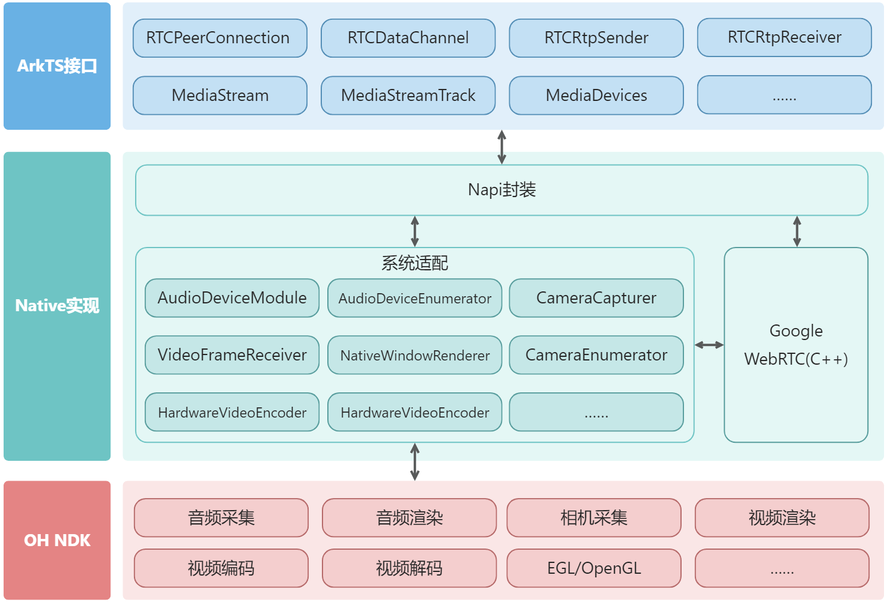

# <center>webrtc</center>

本项目基于 [WebRTC](https://webrtc.googlesource.com/src) 开发。

## 简介

webrtc 是一个适用于 OpenHarmony 的实时通信库，提供 WebRTC 的 ArkTS 接口封装，并在 C++ 层适配了视频采集、渲染及编解码等模块。接口设计遵循 [WebRTC 规范](https://www.w3.org/TR/webrtc/)，同时根据实际需要额外提供了 PeerConnectionFactory 和 AudioDeviceModule 等接口。

**图1** SDK 架构图



## 下载安装

```bash
ohpm install @ohos/webrtc
```

OpenHarmony ohpm 环境配置等更多内容，请参考[如何安装 OpenHarmony ohpm 包](https://gitcode.com/openharmony-tpc/docs/blob/master/OpenHarmony_har_usage.md)。

若需在 NDK C++ 工程中直接集成 `libwebrtc.a`，请参阅[北向应用集成二进制文件](../../docs/ohos/webrtc_adapter_app.md)。

## 约束与限制

### 兼容性

在下述版本验证通过：

- DevEco Studio: NEXT Beta2(5.0.3.900), SDK: API12 Release(5.0.0.71), ROM: 5.0.0.71

> **OHOS SDK 要求 API 12 及以上。**

### 权限要求

打开 `entry/src/main/module.json5`，根据实际功能需求添加以下权限：

```json
"requestPermissions": [
  {
    "name": "ohos.permission.MICROPHONE",
    "reason": "$string:microphone_reason",
    "usedScene": {
      "abilities": ["EntryAbility"],
      "when": "inuse"
    }
  },
  {
    "name": "ohos.permission.CAMERA",
    "reason": "$string:camera_reason",
    "usedScene": {
      "abilities": ["EntryAbility"],
      "when": "inuse"
    }
  },
  {
    "name": "ohos.permission.CAPTURE_SCREEN",
    "reason": "$string:screen_capture_reason",
    "usedScene": {
      "abilities": ["EntryAbility"],
      "when": "inuse"
    }
  }
]
```

## 使用示例

以下示例展示基本的音视频通话建立流程：

```typescript
import webrtc from '@ohos/webrtc';

// 创建 PeerConnectionFactory 实例
let peerConnectionFactory: webrtc.PeerConnectionFactory = new webrtc.PeerConnectionFactory();

// 创建本地音频源和音频轨道
let audioSource: webrtc.AudioSource = peerConnectionFactory.createAudioSource();
let audioTrack: webrtc.AudioTrack = peerConnectionFactory.createAudioTrack('audio', audioSource);

// 创建本地视频源和视频轨道（分辨率 640×480，帧率 15~30fps）
let videoSource: webrtc.VideoSource = peerConnectionFactory.createVideoSource({
  width: 640,
  height: 480,
  frameRate: { min: 15, max: 30 }
});
let videoTrack: webrtc.VideoTrack = peerConnectionFactory.createVideoTrack('video', videoSource);

// 创建 RTCPeerConnection
let peerConnection: webrtc.RTCPeerConnection = peerConnectionFactory.createPeerConnection({
  iceServers: [{ urls: 'stun:stun.example.com' }]
});

// 添加媒体轨道到连接
peerConnection.addTrack(audioTrack);
peerConnection.addTrack(videoTrack);

// 监听 ICE 候选者
peerConnection.onicecandidate = (event: webrtc.RTCPeerConnectionIceEvent) => {
  if (event.candidate) {
    // 通过信令通道将候选者发送给远程对端
  }
};

// 创建并设置本地 Offer 描述
let offer: webrtc.RTCSessionDescriptionInit = await peerConnection.createOffer();
await peerConnection.setLocalDescription(offer);
// 通过信令通道将 SDP offer 发送给远程对端
```

更多使用示例请查看 `har_hap` 目录下的示例工程。动态库的编译方法请参阅[编译文档](../../docs/ohos/webrtc_build.md)，编译过程中遇到问题请参阅[编译常见问题](../../docs/ohos/webrtc_adapter_questions.md)。

## 使用说明

### 1. 创建 PeerConnectionFactory

PeerConnectionFactory 是使用 WebRTC 的入口，用于创建音视频源、轨道和 RTCPeerConnection 实例。

```typescript
import webrtc from '@ohos/webrtc';

// 使用默认配置创建
let factory: webrtc.PeerConnectionFactory = new webrtc.PeerConnectionFactory();

// 使用自定义配置创建
let factoryWithOptions: webrtc.PeerConnectionFactory = new webrtc.PeerConnectionFactory({
  videoEncoderFactory: new webrtc.HardwareVideoEncoderFactory(true),
  videoDecoderFactory: new webrtc.HardwareVideoDecoderFactory()
});
```

> 建议在应用启动时创建 PeerConnectionFactory 实例并调用 `PeerConnectionFactory.setDefault()` 设置为默认实例，以供其他模块（如 MediaDevices）在 C++ 层获取使用。

### 2. 创建音视频源和轨道

```typescript
// 创建音频源和轨道
let audioSource: webrtc.AudioSource = factory.createAudioSource();
let audioTrack: webrtc.AudioTrack = factory.createAudioTrack('audioTrackId', audioSource);

// 创建视频源（可指定分辨率和帧率约束）
let videoSource: webrtc.VideoSource = factory.createVideoSource({
  width: 640,
  height: 480,
  frameRate: { min: 15, max: 30 }
});
let videoTrack: webrtc.VideoTrack = factory.createVideoTrack('videoTrackId', videoSource);
```

### 3. 建立点对点连接

```typescript
// 创建 PeerConnection
let pc: webrtc.RTCPeerConnection = factory.createPeerConnection({
  iceServers: [{ urls: 'stun:stun.example.com' }]
});

// 添加轨道
pc.addTrack(audioTrack);
pc.addTrack(videoTrack);

// 创建 Offer 并设置为本地描述
let offer: webrtc.RTCSessionDescriptionInit = await pc.createOffer();
await pc.setLocalDescription(offer);

// 收到远程 Answer 后设置远程描述
await pc.setRemoteDescription(remoteAnswer);

// 添加 ICE 候选者
await pc.addIceCandidate(remoteCandidate);
```

### 4. 使用数据通道

```typescript
// 创建数据通道
let dataChannel: webrtc.RTCDataChannel = pc.createDataChannel('chat', {
  ordered: true
});

// 监听消息
dataChannel.onmessage = (event: webrtc.MessageEvent) => {
  console.info('收到消息: ' + event.data);
};

// 发送消息
dataChannel.send('Hello WebRTC');
```

### 5. 采集媒体设备

```typescript
let mediaDevices: webrtc.MediaDevices = new webrtc.MediaDevices();

// 获取用户媒体（摄像头/麦克风）
let stream: webrtc.MediaStream = await mediaDevices.getUserMedia({
  video: true,
  audio: true
});

// 屏幕采集
let displayStream: webrtc.MediaStream = await mediaDevices.getDisplayMedia({
  video: {
    ohosScreenCaptureMode: 'home-screen'
  }
});
```

### 6. 视频渲染

```typescript
let renderer: webrtc.NativeVideoRenderer = new webrtc.NativeVideoRenderer();

// 初始化渲染器，绑定 XComponent 的 surfaceId
renderer.init(surfaceId);
renderer.setVideoTrack(videoTrack);
renderer.setMirror(true);
renderer.setScalingMode(1); // 0: 自适应, 1: 拉伸填充
```

> 使用完毕后需调用 `renderer.release()` 释放渲染资源，避免资源泄漏。

### 7. 音频设备管理

```typescript
let audioModule: webrtc.AudioDeviceModule = new webrtc.AudioDeviceModule({
  audioSource: 1,          // SOURCE_TYPE_VOICE_COMMUNICATION
  inputSampleRate: 48000,
  outputSampleRate: 48000,
  useHardwareAcousticEchoCanceler: true,
  useHardwareNoiseSuppressor: true
});

// 控制扬声器和麦克风
audioModule.setSpeakerMute(false);
audioModule.setMicrophoneMute(false);
```

> AudioDeviceModule 使用完毕后需调用 `release()` 释放资源。

## 接口说明

完整接口定义见 `api/libohos_webrtc/webrtc.d.ts`，详细说明请参阅[接口文档](./api/libwebrtc.md)。

### 核心接口

| 名称 | 描述 |
|------|------|
| PeerConnectionFactory | 创建和管理 RTCPeerConnection、音视频源与轨道 |
| RTCPeerConnection | 建立和管理与远程对等端的点对点连接 |
| MediaDevices | 获取用户媒体设备和屏幕采集 |
| MediaStream / MediaStreamTrack | 媒体流与轨道的抽象 |
| RTCDataChannel | 点对点数据通道 |
| AudioDeviceModule | 音频设备管理（扬声器/麦克风控制） |
| NativeVideoRenderer | 视频渲染器，配合 XComponent 使用 |
| HardwareVideoEncoderFactory / HardwareVideoDecoderFactory | 硬件编解码器工厂 |
| NativeLogging | 日志工具 |

## 关于混淆

有关代码混淆的详细信息，请查看[代码混淆简介](https://docs.openharmony.cn/pages/v6.0/zh-cn/application-dev/arkts-utils/source-obfuscation-overview.md)。

若希望 `@ohos/webrtc` 在代码混淆过程中不被混淆，需在混淆规则配置文件 `obfuscation-rules.txt` 中添加以下排除规则：

```
-keep
./oh_modules/@ohos/webrtc
```

## 常见问题

**Q: 编译时遇到 NAPI 相关错误？**

请确保 NDK 环境配置正确。编译前请参阅[编译文档](../../docs/ohos/webrtc_build.md)，常见编译问题可查阅[编译常见问题](../../docs/ohos/webrtc_adapter_questions.md)。

**Q: 视频渲染黑屏？**

确认已正确获取 XComponent 的 surfaceId 并调用 `renderer.init(surfaceId)`。还需确保 `ohos.permission.CAMERA` 权限已正确配置。

**Q: 音频采集无数据？**

确认 `ohos.permission.MICROPHONE` 权限已正确配置，并检查 AudioDeviceModule 的音频源类型和采样率设置是否与设备匹配。

## 目录结构

```shell
sdk/ohos/
├── BUILD.gn            # src 编译脚本
├── api                 # 接口文件
│   ├── ets
│   │   ├── log
│   │   │   └── Logging.ets             # 日志工具
│   │   └── xcomponent
│   │       └── VideoRenderController.ets # 视频渲染控制器（封装 NativeVideoRenderer）
│   ├── libohos_webrtc
│   │   ├── index.d.ts                  # 接口入口（re-export webrtc.d.ts）
│   │   └── webrtc.d.ts                 # 完整接口类型定义
│   └── libwebrtc.md                    # 接口说明文档
├── har_hap             # DevEco Studio 示例工程（HAR 模块 + 示例 HAP 模块）
└── src
    ├── node-addon-api  # 辅助 NAPI 开发的三方库
    └── ohos_webrtc     # C++ 实现源码
        ├── async_work      # 异步任务辅助类
        ├── audio_device    # 音频相关模块
        ├── camera          # 相机相关模块
        ├── desktop_capture # 桌面采集
        ├── helper          # NDK 接口辅助类
        ├── logging         # 日志接口适配
        ├── render          # 视频渲染相关模块
        ├── user_media      # 媒体约束辅助类
        ├── utils           # 工具类
        ├── video           # 视频相关模块
        ├── video_codec     # 视频编解码相关模块
        ├── peer_connection.cpp  # RTCPeerConnection 实现
        └── peer_connection.h    # RTCPeerConnection 头文件
```

## 贡献代码

使用过程中发现任何问题都可以提 [Issue](https://gitcode.com/CPF-ApplicationTPC/ohos_webrtc/issues)，也非常欢迎发 [PR](https://gitcode.com/CPF-ApplicationTPC/ohos_webrtc/pulls) 共建。

## 开源协议

本项目基于 [BSD License](../../LICENSE)，请自由地享受和参与开源。
